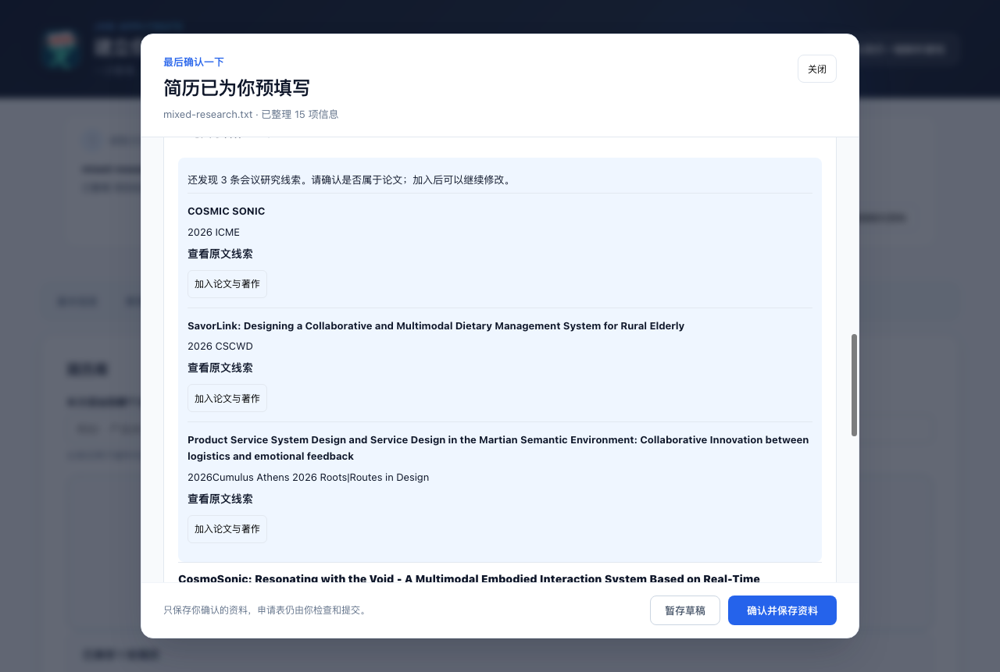

# 混合研究章节的论文补漏

问题：用户的“论文与著作”显示 0 条，但研究章节中有 Art Paper Track、LBW paper、DOI 等线索。仅扩展输出字段不能保证模型将混合章节正确分类；此前解析成功后，没有再次核对原文覆盖情况。截图无法确认该次使用了哪种模型或是否回退到了本地规则，因此修复同时覆盖两条路径。

## 行为

解析提示明确按内容分类：项目 / 科研章节也可含论文，同一研究的工作内容和论文成果可分别保存。展览、SDC 提名不因会议名称自动变成论文；Paper Track Decision 不等于已录用。

在模型解析或本地规则解析之后，增加原文线索检查：从书名号中的完整标题及所属条目提取 Paper / 论文 / DOI 等依据；附在下一行的链接仍属于当前条目，不串到下一个列表项。标题按换行合并，版式插入的行末日期保留在原文说明中。已有论文按标题 / DOI 去重，不替换已有记录。

有明确 Paper / DOI 依据的遗漏条目进入核对草稿，显示补充识别提示。只出现会议名的研究内容显示为候选，用户点“加入论文与著作”才成为草稿记录；未确认候选不保存到个人资料或简历快照。加入后可编辑、暂存、重新打开，再确认保存。

发表日期只从明确的“发表于 / 发表时间 / 录用时间 / 出版时间”提取，不将项目日期或会议年份当成发表日期；发表状态和作者角色只保留原文明示文字。原文在说明中可查看。

## 用户示例回归

固定夹具仅使用研究段落，不含姓名、电话、邮箱或其他个人信息：`tests/resume-fixtures/mixed-research.txt`。

| 原文条目 | 本地补漏结果 |
| --- | --- |
| VINCI / CosmoSonic / Art Paper Track Decision | 论文线索进入核对；不填已录用 |
| ICME / COSMIC SONIC | 候选，手动确认是否为论文 |
| SIGGRAPH / COSMIC SONIC / AIGC 设计展览 | 不自动加入论文 |
| CSCWD / SavorLink | 候选，手动确认 |
| Cumulus / 服务设计研究 | 候选，手动确认 |
| IEEE-HRI / DozeBuddy / DOI 链接 | 文献线索进入核对，保留 DOI 与一作措辞；提名不当作录用 |
| ICHEC / GUAN·ZIZAI·WEILAI / LBW paper | 论文线索进入核对，保留二作措辞 |

补漏得到 3 条论文线索、3 条候选；这不是对真实发表状态的外部核验。日期及状态未明示时留空，项目内容仍保留。

## 验证

- `npm test`：309 项通过；包含混合章节、换行标题、行末版式日期、DOI 归属、部分遗漏、重复处理、展览 / 普通项目不误填、本地规则退路和候选展示检查。
- `npm run build`：TypeScript 与扩展构建通过。
- `npm run lint`：无错误，仍为既有 3 项警告。
- `npm run test:resume-import:browser`：9 项通过。新增场景使用本地模型替身故意返回空 publications、把研究全部归为 projects，再验证原文补漏、候选点击加入、暂存重开、确认保存到全局与文件快照。未确认的候选不会保存。

浏览器验证不调用真实模型，不能证明指定模型的语义准确率。使用时重新加载扩展并重新解析该简历，才能生成新的核对草稿；已有草稿和快照不会自动改写。
