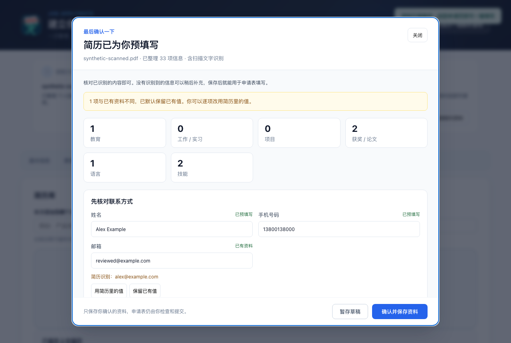

# 简历识别与预填写体验改进

日期：2026-10-01

上传后统一进入读取文件、识别文字、整理资料、确认使用四步流程。扫描 PDF 和 PNG、JPG、JPEG、WebP 图片使用本地中英文 OCR；有可用文本的 PDF 直接提取，避免重复识别。识别文字交给用户已配置的 LLM 整理为资料草稿；未配置或调用失败时明确提示本地规则预填写结果。

## 用户体验

- 自动预填写姓名、联系方式、教育、工作、项目、技能，以及原文明示的链接、语言能力、年龄和期望城市。
- 先展示联系方式和经历摘要；其他资料、详细经历和识别原文按需展开。空白信息可以稍后补充，保存不要求填满所有字段。
- 同一经历按学校或机构、角色及起始日期匹配，填充缺失内容，保留已有冲突值。不同信息提供采用识别值的按钮；姓名不同时先确认这份简历属于用户。
- 草稿支持直接更正、暂存关闭、重新打开，以及停止与重试。错误和真实 OCR 页进度在当前页面显示，文件超过 20 MB、类型不支持或为空时可重新选择。
- 用户确认前不覆盖通用个人资料。确认后只提交审核后的变更，保留新加入的附件和其他页面更新的无关字段；所选简历的资料快照同步使用确认结果。
- 资料准备后继续使用现有申请表填写入口，申请提交仍由用户操作。

## 实现与运行范围

使用 Tesseract.js 7.0.0，Worker、WASM 和中英文语言数据随扩展打包。OCR 不调用云端识别接口；LLM 整理使用现有配置，并发送识别得到的简历文字。图片和扫描页缩放后逐页处理，每份文档复用一个 OCR Worker，并在完成或停止后清理。

PDF 使用兼容构建及无需动画帧的渲染方式，支持隐藏或 offscreen 页面；解析依赖更新为 PDF.js 6.2.108。扩展 CSP 允许本地 WASM，执行代码仍来自扩展自身，不加入远程脚本权限。相关接口见 [Tesseract 官方说明](https://github.com/naptha/tesseract.js/blob/master/docs/api.md) 和 [本地资源配置](https://github.com/naptha/tesseract.js/blob/master/docs/local-installation.md)。

模型输出只接收受约束的文本字段、经历列表和技能，不采用模型生成的记录 ID。日期保留原文精度，缺失的性别、年龄、学校、学位等信息不凭其他内容推断。低清晰度或联系方式格式异常会提示核对，不将 OCR 分数解释为字段正确率。

## 验证

环境：Node 24.16.0，Chrome for Testing 143.0.7499.4。

| 检查 | 结果 |
| --- | --- |
| 单元及组件测试 | 292 项通过 |
| 原有填写浏览器回归 | 68 项通过 |
| 新导入浏览器验证 | 7 项通过 |
| 构建 | TypeScript 和扩展构建通过 |
| lint | 无错误，保留原有 3 项警告 |

导入浏览器验证加载实际扩展并使用真实本地 OCR，覆盖图片识别、扫描 PDF、文本 PDF 快速路径、人工更正后的草稿暂存、附件保留和已确认快照更新、冲突值保护、停止模型处理，以及 375px 界面无横向溢出。使用合成简历和本地模型替身，未发送真实简历或提交招聘申请。

这批测试证明 OCR 和模型调用的实际流程，不衡量真实 LLM 的语义准确率或所有拍摄条件下的 OCR 准确率。复杂版式、模糊或缺字的内容仍需要用户核对；二进制旧 DOC 格式继续受已有解析库能力限制，优先使用 DOCX。

## 复现

- `npm test`
- `npm run lint`
- `npm run build`
- `npm run test:resume-import:browser`
- `npm run test:form-fill:browser`

发布工作流已增加扫描简历导入检查，固定的运行环境与本地验证一致。实际使用 LLM 时，在 AI 设置里配置现有服务；本地 OCR 不要求视觉模型或额外 OCR 服务。
