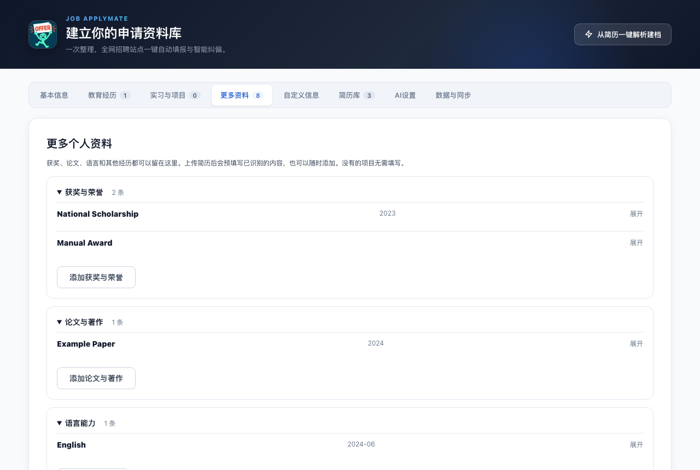

# 个人资料扩充与验证

本次延续上传简历、OCR / 原文读取、现有 LLM 整理、预填写、人工核对的流程。资料收集尽量完整，不增加 embedding 或额外模型路由。没有依据的内容留空，核对表单时可以继续手动补充。

## 收集范围

| 类别 | 保留信息 |
| --- | --- |
| 获奖与荣誉 | 名称、颁奖单位、时间、级别、名次 / 等次、说明 |
| 论文与著作 | 标题、作者与署名顺序、期刊 / 会议 / 出版社、日期、发表 / 录用状态、DOI、链接、贡献 |
| 语言能力 | 语种、熟练程度、考试 / 证书、成绩、日期、使用情况；保留已有语言概述 |
| 证书与资格 | 名称、机构、日期、编号、有效期、说明 |
| 专利与知识产权 | 名称、发明人顺序、申请 / 专利号、类型、申请 / 授权状态、日期、说明 |
| 校园与志愿经历 | 组织、角色、起止时间、活动内容、成果 |
| 其他补充资料 | 信息名称和完整内容，用于驾照、兴趣、培训及未归类事实 |
| 其他基本资料 | 国籍、求职 / 在职状态、意向岗位、期望薪资、到岗时间、GitHub / LinkedIn 链接 |

模型按现有配置解析文字，不推断成绩、年龄、语言等级、作者排名、发表 / 授权状态或求职偏好。无法细分的真实内容进入补充资料；规则解析退路保留已识别类别的章节原文，避免丢掉获奖、论文、语言和校园内容。

## 交互与存储

上传核对页提供各类资料和逐项编辑；设置页新增“更多资料”，只有添加条目后才出现相应输入框。条目可折叠、编辑或删除。网页浮窗及侧栏提供同样的事实，方便用户检查时点选填写。

信息贯穿解析、预填写、确认保存、简历独立快照、版本切换、备份 / WebDAV 恢复和填写事实库。新集合为可选字段，旧备份无需迁移。完整重复条目不会重复导入，不同语言考试仍独立保留；识别值与已有值冲突时默认保留已有值。保存前检查并发修改，保留无关的新附件和资料更新。

## 验证

环境：Node 24.16.0，Chrome for Testing 143.0.7499.4。

| 检查 | 结果 |
| --- | --- |
| 全部单元与组件测试 | 303 项通过 |
| 原有填写浏览器回归 | 68 项通过 |
| 简历导入浏览器验证 | 8 项通过 |
| TypeScript / 扩展构建 | 通过 |
| lint | 无错误，保留原有 3 项警告 |

新增检查覆盖七类资料的解析、预填写、备份恢复、简历快照、重复导入、不同考试保留、并发冲突、旧资料兼容、JSON 导入、规则解析原文保留，以及受约束的填写路径。网页浮窗与侧栏均检查展示内容；模型填写同一考试块时不能混用两个考试记录。

浏览器验证使用真实本地中英文 OCR、合成图片及 PDF、本地模型替身。实际操作语言分数修改、草稿暂存 / 重开、确认后全局与简历快照保存、资料手动添加、刷新和删除；核对页另检查 375px 无横向溢出。测试未衡量真实 LLM 的语义准确率；旧简历文件需要重新解析才能自动获得新增分类。

复现命令：`npm test`、`npm run build`、`npm run lint`、`npm run test:resume-import:browser`、`npm run test:form-fill:browser`。
